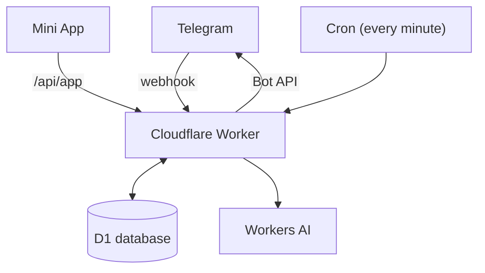

<p align="center">
  
</p>

<h1 align="center">Nag-Bot</h1>

<p align="center">
  A Telegram group bot that keeps a household's chores on one pinned board and nags until someone marks them done.
</p>

<p align="center">
  <a href="https://github.com/nicholas-wan/tele-nagbot/actions/workflows/test.yml"></a>
</p>

<p align="center">
  <a href="https://nicholaswan.me/projects#nag-bot">Interactive demo</a> ·
  <a href="docs/design.md">Design notes</a> ·
  <a href="docs/operations.md">Operations</a>
</p>

Nag-Bot runs on Cloudflare Workers with a D1 database and a one-minute cron.
Someone adds a chore by typing it the way they would say it, the bot pins a
board of everything that is due, and when a chore comes up it nags the group
(or just the person it is assigned to) every so often until somebody taps
Done. Our two cats, Latte and Mocha, do the nagging.

## Features

- **Plain-language chores.** `/chore trash 7pm daily`, `every mon,thu 8am`,
  `every other saturday` or `pay tax friday` become schedules. A missing time
  opens a picker with a suggested slot; anything the parser cannot read safely
  is refused rather than misread.
- **Nags that keep going.** Re-nags at 15, 30 and 60 minutes, with Done,
  Done together, Snooze and Delete on every card. Replying `done`,
  `snooze 2h` or reacting 👍 works too. Quiet hours hold re-nags until 8am.
- **One pinned board.** Every chore in urgency order, two short lines each,
  edited in place rather than reposted.
- **Fair shares.** Assign a chore to someone, rotate it to whoever has done it
  least, or leave it to anyone. `/chore` scores on a weekly leaderboard with
  streaks; `/remind` is the same thing without points.
- **Nested chores.** A chore can reset others under it: washing the litter box
  covers clearing it.
- **Undo everywhere.** Every Done, delete and add can be taken back for a day.
- **Private by default.** Replies, wizards and assigned nags are ephemeral
  messages only the recipient sees; the group sees only what it shares.
- **Mini App.** A Telegram Mini App for the chore list, each chore's settings
  and the stats, opened from the board.
- **Extras.** An 8am digest of anything left overnight, a Sunday wrap,
  vacation mode (`/pause all 14`), cat stickers tagged by Workers AI, and
  `/invite` for calendar files.

## How it works



- **Webhook** (`POST /webhook`): messages, button taps, reactions and
  membership changes. Each update is stored and claimed once, so a redelivery
  is never handled twice.
- **Cron**: fires due chores, sends re-nags (hourly once a chore is a day
  overdue; nothing expires until someone marks it done), posts the digest and
  weekly wrap, and sweeps old messages. An idle tick is one database round
  trip.
- **Mini App**: a static page served from `public/app/`. Its requests are
  checked against Telegram's signed launch data and the user's membership of
  the group.
- **D1**: chores, firings (one per occurrence), completions and the message
  log. Every state change is a conditional update, so racing taps and cron
  ticks cannot double-fire or double-count. The Worker is placed in Europe,
  next to the database and Telegram's servers.

## Getting started

### Prerequisites

- Node.js 24 (the tests use `node:sqlite`)
- A Cloudflare account with Workers, D1 and Workers AI
- A Telegram bot from [@BotFather](https://t.me/BotFather)

### Set up

1. Add the bot to the group as an admin with **Pin Messages** and
   **Delete Messages**. Admin status is also what lets it send ephemeral
   messages.
2. Install, configure and create the database:

   ```powershell
   npm install
   Copy-Item wrangler.example.toml wrangler.toml
   npx wrangler login
   npx wrangler d1 create nagbot-eu --location weur
   ```

   Put the new database's id in `wrangler.toml` under `[[d1_databases]]` and
   fill in the [configuration](#configuration).

3. Create the tables, add the secrets and deploy:

   ```powershell
   npm run db:init
   npx wrangler secret put BOT_TOKEN
   npx wrangler secret put WEBHOOK_SECRET
   npx wrangler secret put ADMIN_SECRET
   npm run deploy
   ```

   `npm run deploy` runs the test suite first and refuses to ship if it fails.

4. Register the webhook and command menu:

   ```powershell
   curl.exe -X POST -H "Authorization: Bearer YOUR_ADMIN_SECRET" `
     https://YOUR-WORKER.workers.dev/setup
   ```

An existing database also needs the numbered migrations: `npm run db:migrate`.
See [Migrations](docs/operations.md#migrations).

### Admin endpoints

All except the health check are `POST` and need
`Authorization: Bearer <ADMIN_SECRET>`.

| Path | What it does |
|---|---|
| `/setup` | Registers the webhook and command menu |
| `/admin?info` | Reads back the webhook and registered commands from Telegram |
| `/admin?diag[=<chat>]` | Membership, admin rights and whether the chat id changed |
| `/admin?board` | Rebuilds and re-pins the board |
| `/admin?stickers&chat=<id>` | Lists sticker tags |
| `/` | Health check |

## Configuration

Set these under `[vars]` in `wrangler.toml`. `wrangler.example.toml` has a
commented example of each.

| Variable | Purpose |
|---|---|
| `ALLOWED_CHATS` | Comma-separated chat ids the bot answers in. Everything else is ignored; missing config fails closed |
| `NICKNAMES` | Optional. Assignee shortcuts, as `nic=@handle, yx=@handle` |
| `MINI_APP_URL` | Optional. The Mini App's BotFather link; turns the board's button into 🐾 Chores |
| `EPHEMERAL` | Optional. `"0"` makes every message public again |

Secrets, set with `npx wrangler secret put`:

| Secret | Purpose |
|---|---|
| `BOT_TOKEN` | The bot's token from BotFather |
| `WEBHOOK_SECRET` | Checked on every webhook call |
| `ADMIN_SECRET` | Protects the admin endpoints |

The D1 database is bound as `DB` and Workers AI as `AI`. Each chat's timezone
defaults to `Asia/Singapore`.

## Usage

```text
/chore trash 7pm daily        counts on the leaderboard
/remind pay tax friday        same syntax, no points
/chore @jane dishes now       assign it; or rotate to fair-share it
/invite bday lunch 13 sep 12pm at Fu Yuan, 80 Middle Rd
```

Schedules read the way people type them: `every mon,thu 8am`, `tue/fri`,
`every 8 days`, `weekly shop sat 10am`, `fortnightly`, `every 1st`,
`every other saturday`, `weekdays`, `starting 29 aug`, `tmr 730pm`,
`in 20m`, `nag:10m`. More in [docs/design.md](docs/design.md#adding-chores).

| Command | What it does |
|---|---|
| `/chore`, `/remind` | Add a chore (scores) or a reminder (no points) |
| `/list` | Show and re-pin the board |
| `/done`, `/skip` | Finish a chore now or early, or skip its next slot |
| `/edit`, `/delete` | Change or remove a chore, by name |
| `/pause`, `/resume` | Pause one chore |
| `/pause all 14`, `/resume all` | Vacation mode for up to 90 days |
| `/poke` | Re-send every outstanding nag |
| `/stats` | This week, last week and six months |
| `/invite` | A calendar file for an event, with the address detected |
| `/makestickers`, `/usepack`, `/tagsticker`, `/tags`, `/autotag` | Set up and tag the cat sticker pack |
| `/help` | Examples and the shortcuts in force |

Commands that name a chore match it by name; a near miss is offered back as a
command to tap rather than acted on.

## Testing

```powershell
npm test
```

The suite uses [Vitest](https://vitest.dev/) and runs the database tests
against an in-memory SQLite copy of the schema. GitHub Actions runs it on every
push and pull request. `node bench/latency.mjs` replays the common flows with
simulated D1 and Telegram latency and prints reply times.

## Project structure

```text
src/
  index.js        Webhook, cron, Mini App and admin routes
  updates.js      Webhook intake, dedup and recovery
  handlers.js     Commands, replies, reactions and button taps
  parse.js        Reads free-text chores and schedules
  wizard.js       The time picker for chores typed without a time
  nag.js          Nag cards and the completion state machine
  chores.js       Create, find, delete, pause, done early, vacation
  nesting.js      Nested chores
  cron.js         Fire, re-nag, digest, weekly wrap, sweep
  dashboard.js    The pinned board
  manage.js       Manage and editor flows on the board
  stats.js        Leaderboard, history and streaks
  miniapp-*.js    Mini App API, sign-in check and link
  ...
public/app/       The Mini App page
schema.sql        Full database schema
migrations/       Upgrades for databases created before a change
test/             Vitest suites
bench/            Latency replay
docs/             Design notes and operations
```

## Further reading

- [docs/design.md](docs/design.md): how chores, nags, the board, privacy and
  the Mini App behave, and why
- [docs/operations.md](docs/operations.md): configuration in full,
  deployment, admin endpoints, migrations, performance and debugging
